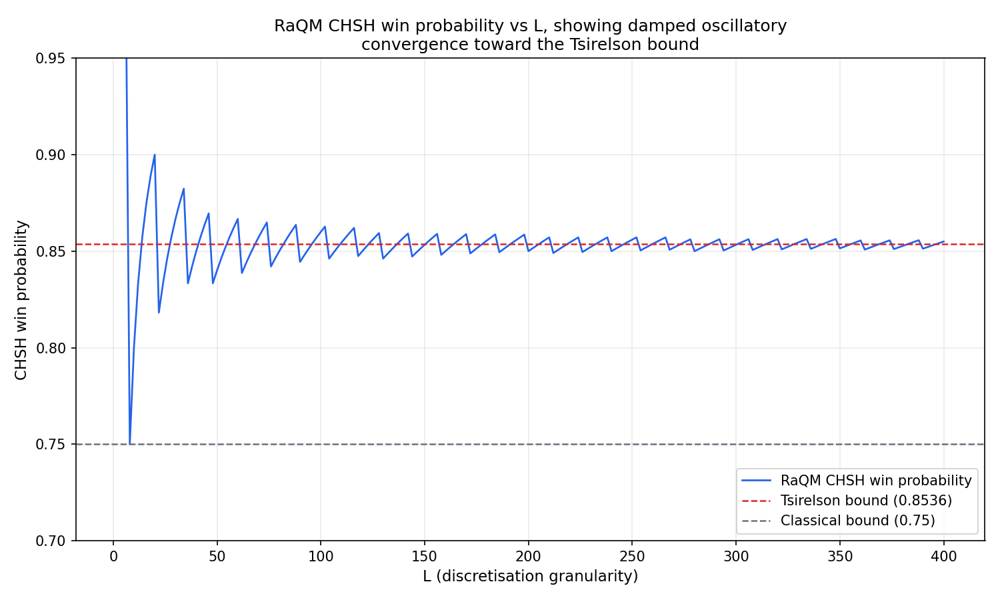

After reading Tim Palmer's recent arXiv paper on **Rational Quantum Mechanics (RaQM)**, I got curious about a concrete question the paper itself doesn't work out: what happens if you actually try to play the CHSH game — the classic experimental test of Bell's inequality — inside RaQM's discretised framework, at different levels of granularity?

This post walks through the construction and the result.

## RaQM in one paragraph

RaQM proposes that a qubit's measurement basis, at colatitude θ on the Bloch sphere, is only mathematically defined if

**cos²(θ/2) = m/L**

for integers m ≤ L. Here L is a single granularity parameter: L=∞ recovers ordinary continuum quantum mechanics exactly; smaller L restricts which bases are even definable. Crucially, RaQM doesn't modify the Schrödinger equation or Born's rule — it only adds this admissibility filter on top of otherwise-standard quantum mechanics.

## Building the discretised Riemann Sphere, inductively

Palmer gives an explicit construction only up to L=4, built from a simple axiom: the imaginary unit *i* acts on a 2-bit string as a permutation-negation operator,

**i{a₁, a₂} = {−a₂, a₁}**

At L=2, this alone generates four points: {1,1}, {−1,1}, {−1,−1}, {1,−1} — north pole, equator (two points), south pole.

The inductive step doubles the string length at each stage. To build the L=2M sphere from two already-complete L/2 spheres, split the L-bit string into two concatenated L/2-bit halves and apply two *different* branches of the smaller construction to each:

- For the **upper half** of points (m ≥ L/2, i.e. θ ≤ 90°): hold the first half fixed at its own north pole (all +1s), and let the second half trace out the smaller sphere's **φ=0** branch, indexed by (m − L/2).
- For the **lower half** of points (m < L/2, θ > 90°): hold the second half fixed at its own south pole (all −1s), and let the first half trace out the smaller sphere's **φ=π** branch, indexed by m.

Each application of this rule doubles the resolution: L=2 → L=4 → L=8 → L=16, and so on.

## Worked example: L=8

Starting from Palmer's own verified L=4 table (both φ=0 and φ=π branches):

| m | θ | φ=0 string | φ=π string |
|---|---|---|---|
| 4 | 0° | [1,1,1,1] | [1,1,1,1] |
| 3 | 60° | [1,1,-1,1] | [-1,1,1,1] |
| 2 | 90° | [1,1,-1,-1] | [-1,-1,1,1] |
| 1 | 120° | [1,-1,-1,-1] | [-1,-1,1,-1] |
| 0 | 180° | [-1,-1,-1,-1] | [-1,-1,-1,-1] |

applying the doubling rule once gives the L=8 sphere:

| m | θ | string |
|---|---|---|
| 8 | 0.00° | [1,1,1,1,1,1,1,1] |
| 7 | 41.41° | [1,1,1,1,1,1,-1,1] |
| 6 | 60.00° | [1,1,1,1,1,1,-1,-1] |
| 5 | 75.52° | [1,1,1,1,1,-1,-1,-1] |
| 4 | 90.00° | [1,1,1,1,-1,-1,-1,-1] |
| 3 | 104.48° | [-1,1,1,1,-1,-1,-1,-1] |
| 2 | 120.00° | [-1,-1,1,1,-1,-1,-1,-1] |
| 1 | 138.59° | [-1,-1,1,-1,-1,-1,-1,-1] |
| 0 | 180.00° | [-1,-1,-1,-1,-1,-1,-1,-1] |

Note the angles aren't evenly spaced — they cluster near the poles and spread out near the equator, since θ = 2·arccos(√(m/L)) isn't linear in m. Also note that 90° and 120° land exactly where continuum QM would put them (both are angles with rational cosine, so they're exact at *every* L), while 41.41° and 138.59° are RaQM's best available approximations to what continuum QM would put at 45° and 135° — angles that, having irrational cosine, are never exactly representable at any finite L.

## Formulating the CHSH game

For an entangled pair, Alice's own marginal outcome distribution is always exactly 50/50, regardless of her chosen measurement angle — a robust feature of maximal entanglement, not something that needs rounding. What actually carries the physics is the *relative* angle δ between Alice's and Bob's chosen bases: it determines Bob's outcome distribution conditional on each of Alice's two possible results. Only this one angle needs to satisfy RaQM's admissibility condition; everything else follows automatically (in particular, if δ is admissible, so is its complement 180°−δ, guaranteeing Bob's own marginal also stays exactly 50/50).

Using the canonical CHSH strategy (Alice measures at 0° or 90°; Bob measures at 45° or −45°), the four required relative angles are −45°, +45°, +45°, and +135°. Since 45° isn't exactly representable at any finite L, each of these gets rounded to the nearest admissible angle at whatever L we're testing, and the resulting win probability is computed directly from the rounded, exact quantum-mechanical correlations.

## Results

Computing the win probability across a wide range of L:

The classical bound is 0.75; the true quantum (Tsirelson) optimum is cos²(π/8) ≈ 0.8536.

A few notable features:

- **At L=8, RaQM predicts exactly the classical bound (0.75)** — no observable quantum advantage at all, despite the state being maximally entangled.
- **Convergence to the true value is not monotonic.** The curve overshoots, undershoots, and overshoots again as L increases, with the amplitude of these oscillations shrinking steadily.
- **Sweeping over every even L** (not just powers of two) reveals a sawtooth structure layered on top of the overall trend — long stretches of gradual improvement punctuated by sharp resets, a direct consequence of how "nearest rational approximation" behaves as its denominator increases one step at a time.
- **By L≈1000, the result has settled to 0.85352**, within 0.00004 of the true Tsirelson bound.

This is a fairly concrete illustration of RaQM's central claim — that standard quantum mechanics, Bell violation included, is recovered exactly in the L→∞ limit — while also showing a texture the paper's abstract description doesn't make obvious: the convergence looks like a form of discretisation noise, oscillating around the true answer rather than approaching it smoothly.

*(Caveat: Palmer's paper gives the explicit discretised-sphere construction only up to L=4; the extension to larger L used here follows the stated inductive rule but is not independently verified beyond that point.)*
